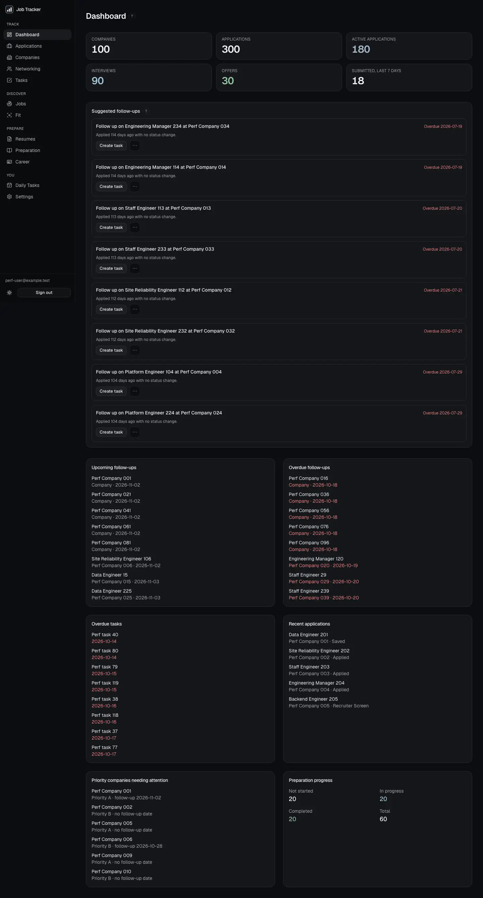
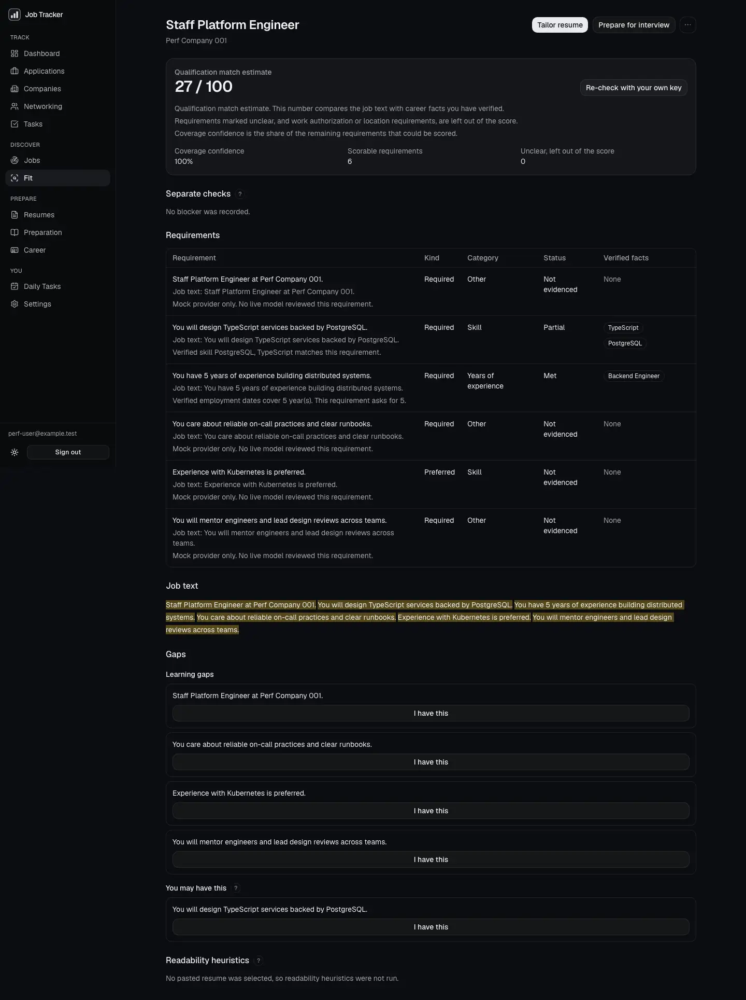
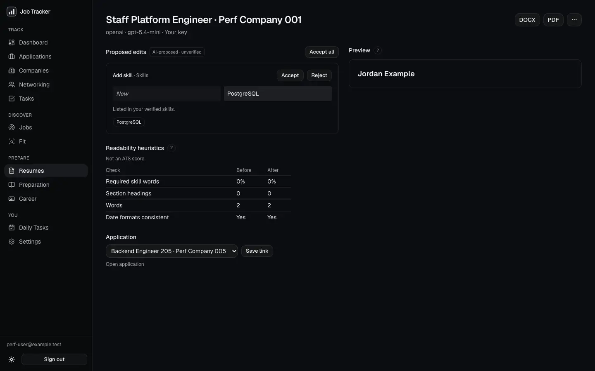
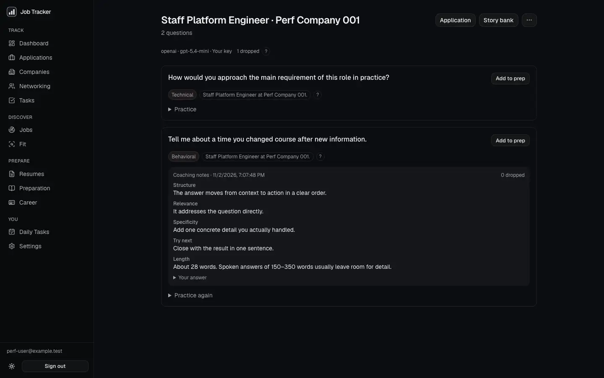
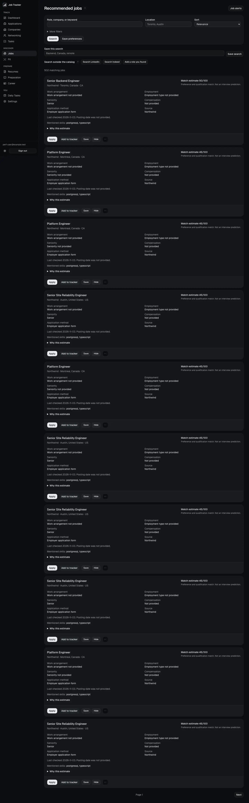
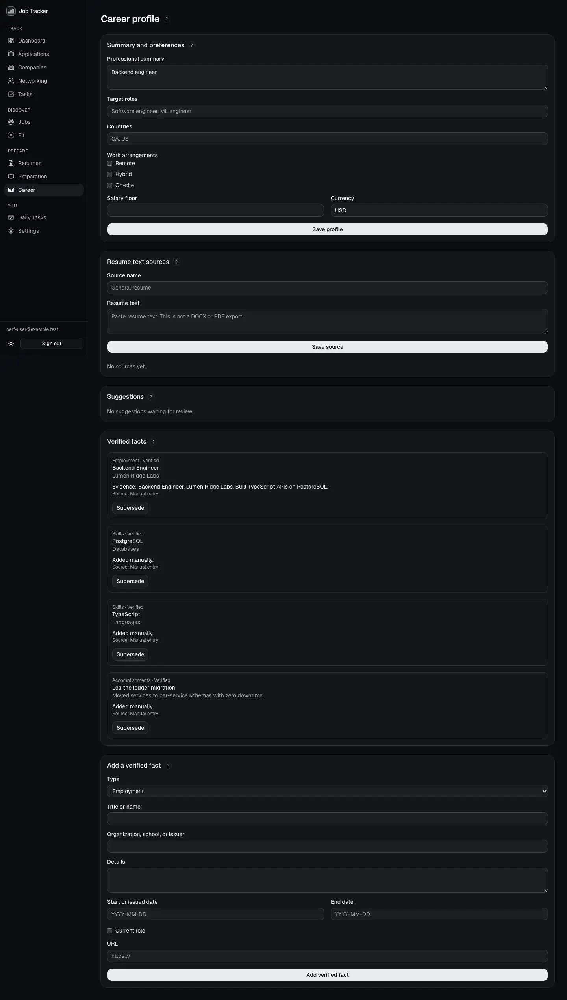
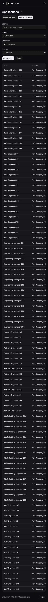
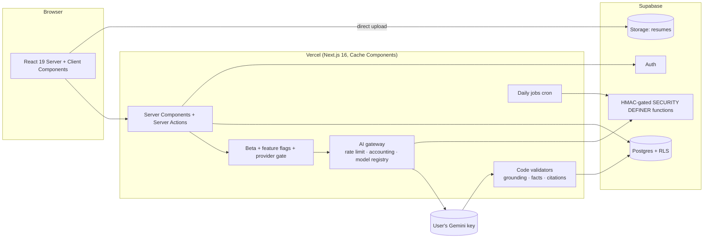

# Job Tracker

A private workspace for running a job search: applications, companies, contacts, tasks, and interview prep, plus an AI layer that analyzes job descriptions, tailors resumes, and coaches interviews and outreach. The AI layer runs on **your own key** and is checked in code against **facts you verified**.

**Live app:** [jobtracker.varunsr.com](https://jobtracker.varunsr.com). You sign up with an email address, and you must verify it before you can use the app. The AI features are in a closed beta.



| Fit analysis | Tailored resume | Interview prep |
|---|---|---|
|  |  |  |

| Recommended jobs | Career profile | Mobile |
|---|---|---|
|  |  |  |

## What it does

**Tracking (live for everyone)**
- Application pipeline with status changes, companies, contacts, one-time tasks, interview and certification prep, and a dashboard of upcoming actions.
- Recurring daily tasks with weekday schedules and weekly insights.
- Optional health tracking.
- CSV and XLSX import with duplicate detection, plus CSV export.

**V2 (closed beta, server flags)**
- **Career profile.** Paste your resume or notes. The AI suggests facts, and nothing is used until you accept it.
- **Fit analysis.** Paste a job description to get requirements, each quoted from the posting, matched against your verified facts. The matching is done by code; the model gives no score.
- **Resume Studio.** Upload a PDF or DOCX, parse it, and tailor it to an analysis. Each edit is a proposal that must cite your facts and the posting. You accept or reject edits one by one, then export to PDF or DOCX.
- **Interview & networking coach.** Interview questions from an analysis, a STAR story bank, typed practice with notes, company research from text you provide, outreach drafts, and follow-up suggestions. Nothing is ever sent for you.
- **Recommended jobs.** A shared catalog from approved public job boards, private preferences, and optional alerts.
- **Paste a job posting.** For Workday, LinkedIn, or company-site postings that cannot be ingested: paste the text, and AI fills in company, title, location, arrangement, employment type, salary, and requisition ID. Only values found in your text are kept. You review the form before saving, duplicates are caught, and fit analysis is one click away. The app never opens the link.

## How it works



- **Every query runs as the user.** The app has no service-role client. Row Level Security scopes every table to its owner. The few writes that must cross users, such as AI usage accounting and the shared job catalog, go through `SECURITY DEFINER` functions that require an HMAC proof signed with a server-only secret.
- **The model proposes; code verifies.** Requirements must be quoted word for word from the posting. Resume edits and drafts may only use facts the user accepted. Research claims must cite text the user provided. Anything that fails a check is dropped before it is saved, and the model never produces a score.
- **Bring your own key.** Provider keys are encrypted with AES-256-GCM using a server key, are never sent back to the browser, and never appear in logs or Sentry. Gemini is the only live-verified provider. OpenAI and Anthropic stay hidden unless an operator enables them, and then they carry a "Beta — not live-verified" label.
- **Closed beta.** `BETA_USER_IDS` gates every V2 page, action, and AI run on the server. If the list is malformed, nobody gets access.
- **Abuse limits.** Each user gets 6 AI runs per minute and 80 per day, counted from the usage log. A strict CSP limits connections to the configured Supabase origin, along with HSTS and COOP. Sentry is opt-in and scrubs emails, keys, tokens, and ids.
- **Caching rule.** Only public, user-independent data may ever be shared-cached, and a test enforces this.

More detail: [architecture](docs/architecture.md) · [AI](docs/ai.md) · [fit analysis](docs/analyze.md) · [Resume Studio](docs/resume-studio.md) · [coach](docs/career-coach.md) · [jobs](docs/jobs.md) · [data model](docs/data-model.md) · [launch runbook](docs/launch.md).

## Decisions worth noting

| Decision | Why |
|---|---|
| BYOK only, no managed AI at launch | No platform spend or key custody risk. Managed mode exists behind its own flags and is unreachable unless enabled. |
| Gemini only in production | It is the only provider verified end to end with a real key. Model ids are checked against provider docs ([docs/ai.md](docs/ai.md)). |
| Code checks, not model scores | Fit is computed from requirement-to-fact matches, so the model cannot inflate a candidate's fit. |
| HMAC-gated definer functions instead of a service-role key | A leaked environment cannot bypass RLS, and the secret lives in the database and the server only. |
| No new tables for rate limits | The limit counts existing `ai_usage_events`, so launch needed only one read-only migration. |
| Flags default off | Merging changes nothing for users. An operator turns each feature on per environment. |

## Testing and evals

| Layer | Command | Count / gate |
|---|---|---|
| Unit, component, in-memory DB (PGlite), local Supabase RLS | `npm test` | 645 tests in 85 files |
| End to end (Playwright, `next start`, fake provider, Turnstile test key) | `npm run test:e2e` | 41 tests: core flows on every feature, with the production CSP enforced |
| AI evals (prompts + validators, planted fabrications/injections) | `npm run test:eval` | CI fails below 100% safety |
| Lint, types, build | `npm run lint`, `npm run typecheck`, `npm run build` | CI |

The latest eval run is in [docs/evals/latest.md](docs/evals/latest.md):

- **Live Gemini run** (`gemini-3.5-flash-lite`):
  - 100% of 56 planted fabrications dropped;
  - 100% of 3 prompt injections dropped;
  - 100% citation validity;
  - requirement extraction, all sets: precision 97.2%, recall 96.4%;
  - on four held-out postings never used for tuning: precision 100%, recall 96.8% (83.9% recall with the previous prompt).
- **Correction.** The 60% precision reported at M6c came from incomplete gold labels, not model errors. How this was found and fixed is in [docs/analyze.md](docs/analyze.md#extraction-precision-v2-wrap-up-prompt-version-job-fit-2026-11-11).
- **Mock suite:** runs in CI and fails if a safety check is weakened. Breaking the edit validator drops the fabrication catch to 88% and fails the build.

## Performance

Measured with Lighthouse plus Postgres statement stats on a seeded dataset (300 applications, 500 postings). Every measured page scores 100 for accessibility except Career (96). First-load JS stays within 5% of the previous milestone on every route. Full tables: [docs/perf](docs/perf).

| Page | First-load JS (KB, transfer) | Lighthouse perf | a11y | LCP (ms) | Supabase calls |
|---|---|---|---|---|---|
| Dashboard | 217.6 | 93 | 100 | 3248 | 12 |
| Applications list | 183.3 | 94 | 100 | 3096 | 5 |
| Jobs | 187.4 | 95 | 100 | 2957 | 8 |
| Fit analysis result | 186.2 | 95 | 100 | 2956 | 12 |
| Resumes | 184.4 | 94 | 100 | 3084 | 6 |
| Career | 221.1 | 94 | 96 | 3091 | 15 |

Measured with Lighthouse's simulated mobile throttling. Since the M6a optimization pass, Daily Tasks first-load JS fell from 291 to 191 KB, and each page now makes 2 auth calls per render. Full history: [baseline](docs/perf/baseline.md) → [M6a](docs/perf/after.md) → [M6b](docs/perf/m6b.md) → [M6c](docs/perf/m6c.md) → [V2](docs/perf/v2.md).

## Status

| Capability | Status |
|---|---|
| Tracking, daily tasks, import/export, health | **Production, active** |
| Recommended jobs | **Production, active** for the allowlisted user; beta users once `BETA_USER_IDS` is set |
| Career profile, fit analysis, Resume Studio, coach, paste-a-job | **Beta**: built and verified, off until the [launch runbook](docs/launch.md) steps |
| Gemini (BYOK) | **Beta**: live-verified (evals and walkthroughs) |
| OpenAI, Anthropic | **Not live-verified**: mock-tested only, hidden in production |
| Managed AI | Built; unreachable unless enabled |
| CAPTCHA (Cloudflare Turnstile) | Ready; off until `NEXT_PUBLIC_TURNSTILE_SITE_KEY` is set, then Supabase CAPTCHA (runbook step 7) |
| Sentry | Ready; active only with `SENTRY_DSN`; the tunnel relays only to your project |

## Limitations

- **Extraction misses:** it still misses a location named only in a posting's opening sentence, and treats buzzword-only "requirements" as duties. Live output varies a little from run to run.
- **PDF fonts:** the resume PDF export covers Latin, Latin Extended, and Vietnamese scripts. CJK, Arabic, and similar scripts are not covered yet.
- **npm audit:** production reports 0 high or critical advisories, plus 8 low or moderate ones. They are in CLI-only `shadcn` dependencies and `exceljs`'s `uuid`, which is called without the vulnerable argument. Fixing them would need breaking major changes ([docs/dependencies.md](docs/dependencies.md)).
- **Rate limits:** they count runs, not provider calls. One run can make up to 3 attempts plus 1 repair, and each can repeat once on the Gemini fallback. With BYOK that only spends the user's own key. They also fail open if the usage table cannot be read.
- **Model provenance:** usage-accounting rows record the requested model. Saved results record the model that actually answered.
- **Reviews:** no independent security audit or certification; the reviews were internal, by a separate reviewer agent (see the M6c and V2 wrap-up PRs).

## Roadmap

See [docs/roadmap.md](docs/roadmap.md): managed AI with spend caps, live-verifying OpenAI and Anthropic, an email alert sender, more job-board sources, resume templates, OCR, cover letters, and a local AI companion. A portfolio write-up is in [docs/case-study.md](docs/case-study.md), and release notes are in [CHANGELOG.md](CHANGELOG.md).

## Local development

Developed with Node.js 24 and npm 11.

```bash
git clone https://github.com/VCRAM99/job-application-tracker.git
cd job-application-tracker
npm install
npx supabase start
```

Put the local Supabase URL and publishable key into `.env.development.local` (see `.env.example`), then run:

```bash
npm run dev
```

`npm run dev` refuses to start unless `NEXT_PUBLIC_SUPABASE_URL` is the local stack (`http://127.0.0.1:54321`), so a development session cannot write to a hosted project by accident. Locally, every V2 feature and provider is available once its flag is set; on Vercel each one is closed until configured. Hosted setup is in [docs/setup.md](docs/setup.md), and production activation is in [docs/launch.md](docs/launch.md).

| Command | Purpose |
| --- | --- |
| `npm run dev` | Development server (local Supabase only) |
| `npm run typecheck`, `npm run lint` | TypeScript, ESLint |
| `npm test` | Vitest |
| `npm run test:e2e` | Playwright against local Supabase |
| `npm run test:eval` | AI eval suite (mock). `npx tsx --conditions=react-server scripts/eval/run.ts --live` uses your Gemini key |
| `npm run build` | Production build |
| `npm run perf:seed`, `npm run perf:measure` | Performance dataset and measurement |

## Developer

Developed by Varun Ramanathan. Portfolio: [varunsr.com](https://varunsr.com) · GitHub: [VCRAM99](https://github.com/VCRAM99)
